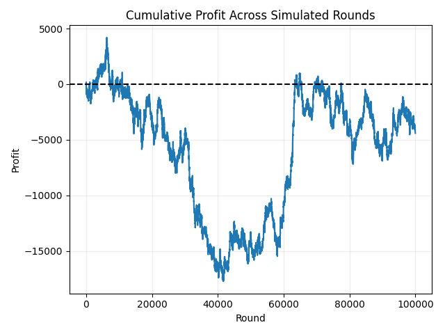
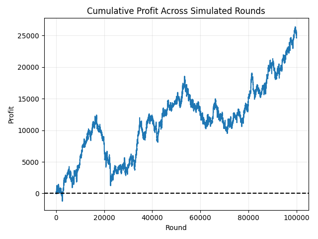

# Blackjack Card Counting Simulator

A Python blackjack simulator that combines **basic strategy**, **Hi-Lo card counting**, and **true-count-based bet sizing** to study the long-run behavior and variance of card counting.

The project can simulate large numbers of blackjack rounds, track cumulative profit, and compare results across different true counts and betting levels.

## Project Goals

This project was built to explore questions such as:

- How does card counting affect expected blackjack results?
- How volatile can cumulative profit be even when a player has an advantage?
- How does bet sizing change as the true count increases?
- How much do outcomes vary across long simulations?

The simulator is intended as an educational and statistical modeling project rather than a guarantee of real-world gambling profits. The default run simulates 100,000 rounds and displays summary statistics and a cumulative-profit graph. It is important to note that in its current state, this simulation is very volatile due to there being less limitations. The simulation is not subjected to many of rules that casinos would potentially have, meaning that this simualtion is not truly representative of how counting cards in blackjack might play out in the real world.p

### Example Outcomes:



## Features

- Multi-deck blackjack shoe simulation
- Hi-Lo running count
- True count calculation based on decks remaining
- Automated blackjack basic strategy
- Splitting
- Doubling
- Late surrender
- Dealer hits soft 17
- Double after split
- Blackjack pays 3:2
- True-count-based betting
- Adjustable deck count and penetration
- Reproducible simulations using random seeds
- Cumulative-profit plotting
- Results grouped by true-count bucket
- Interactive card-counting trainer

## Default Simulation Setup

The main simulation currently uses:

- **4 decks**
- **75% penetration**
- **100,000 rounds**
- **$10 base betting unit**
- **Hi-Lo counting system**
- **1-to-12 betting spread**

### Betting Ramp

| Floored True Count | Bet |
|---:|---:|
| Below +1 | $10 |
| +1 | $20 |
| +2 | $40 |
| +3 | $80 |
| +4 or higher | $120 |

The bet is determined before each round using the current true count.

## Project Structure

```text
.
├── main.py
├── simulation.py
├── blackjack_game.py
├── basic_strategy.py
├── betting.py
├── shoe.py
├── tracking_count.py
├── count_trainer.py
└── README.md
```

### `main.py`
Entry point for running the simulation.

### `simulation.py`
Runs repeated blackjack rounds, tracks cumulative profit, records statistics, and produces the cumulative-profit graph.

### `blackjack_game.py`
Contains the blackjack game engine, including dealing, hitting, standing, splitting, doubling, surrender, dealer play, and payout logic.

### `basic_strategy.py`
Implements automated blackjack basic strategy for the rule set used by the simulator.

### `betting.py`
Calculates the true count and converts it into a wager using the configured betting ramp.

### `shoe.py`
Creates and shuffles multi-deck blackjack shoes.

### `tracking_count.py`
Implements the Hi-Lo counting system and count visualization.

### `count_trainer.py`
Provides an interactive exercise for practicing the running count.

## Running the Project

Clone the repository:

```bash
git clone https://github.com/bennettbra/blackjack-card-counting-simulator.git
cd blackjack-card-counting-simulator
```

Install the required package:

```bash
pip install -r requirements.txt
```

Run the simulation:

```bash
python main.py
```

## Why the Profit Curve Is Volatile

Card counting does not create a large guaranteed advantage on every hand.

Instead, the player:

1. Makes small bets when the count is unfavorable or neutral.
2. Makes larger bets when the true count indicates a more favorable deck composition.
3. Still experiences substantial short-term randomness.

Because the largest wagers occur during high-count situations, losing several large bets in a row can create sharp drawdowns. Splits and doubles can increase the amount exposed during a single round even further.

For that reason, one simulation path should not be interpreted as the expected result of the strategy. A stronger analysis would compare many independent simulations.

## Current Limitations

Important real-world considerations that are not yet fully modeled include:

- Finite player bankroll
- Risk of ruin
- Table minimum and maximum restrictions
- Casino countermeasures
- Heat and player detection
- Bankroll-based bet sizing
- True-count strategy deviations from basic strategy
- Realistic rounds-per-hour constraints
- Multiple simultaneous players

The current wagering summary also tracks the initial wager for each round rather than every additional amount committed through splits and doubles. A future version should track total money wagered more precisely before calculating return on investment.

## Planned Improvements

- Add a bankroll model
- Calculate maximum drawdown
- Calculate risk of ruin
- Track total money wagered including splits and doubles
- Run many independent Monte Carlo simulations
- Plot the distribution of final profits
- Calculate confidence intervals for expected profit
- Compare flat betting against count-based betting
- Compare different bet spreads
- Add true-count strategy deviations
- Add unit tests for game rules and payouts

## Statistical Interpretation

A single cumulative-profit graph is one realization of a random process.

For a stronger statistical analysis, the simulator can be extended to run hundreds or thousands of independent trials and analyze:

- Mean final profit
- Median final profit
- Standard deviation
- Probability of finishing profitable
- Maximum drawdown
- Risk of ruin
- Confidence intervals

This would make it possible to distinguish expected performance from short-term randomness.


## Author

Brandon Bennett  
UNC–Chapel Hill
